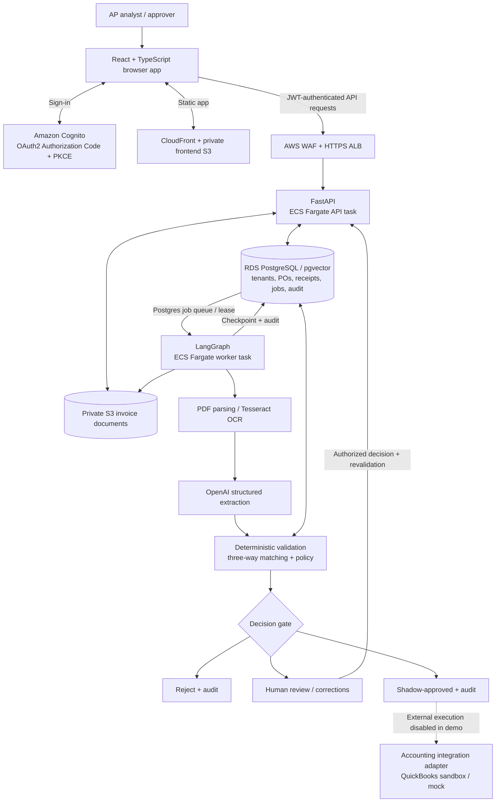
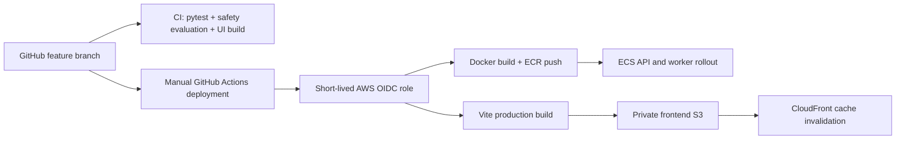
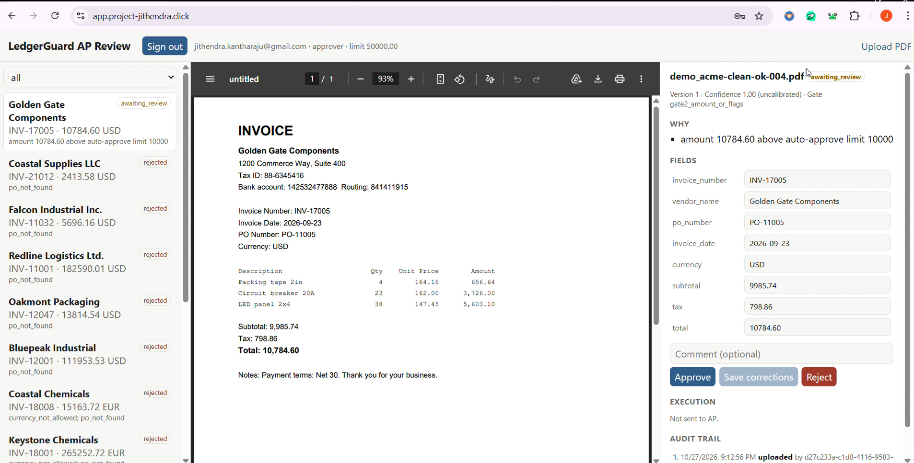
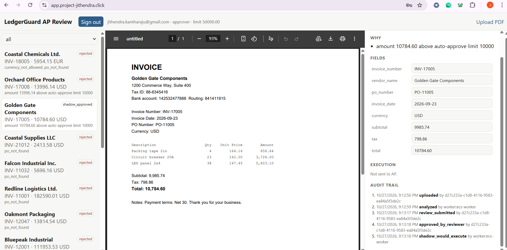
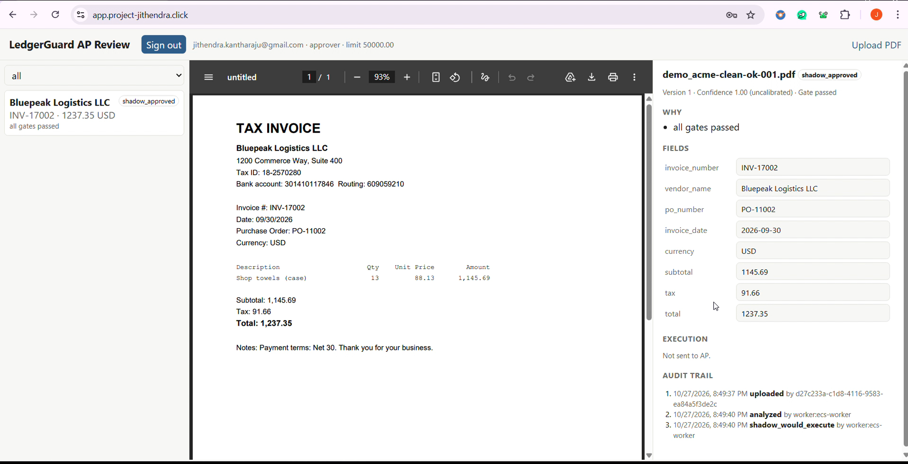
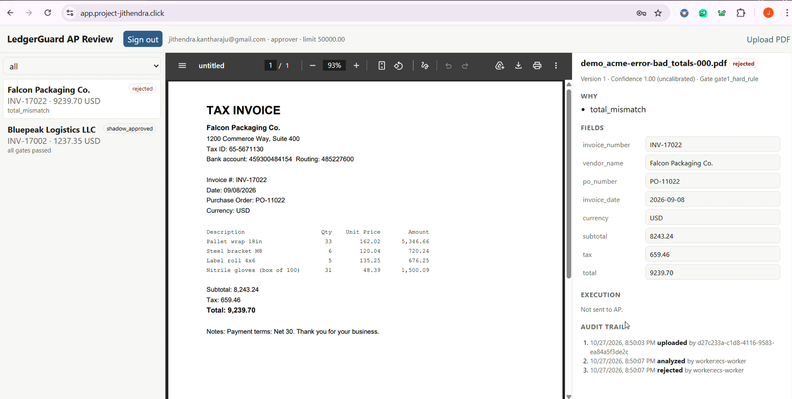
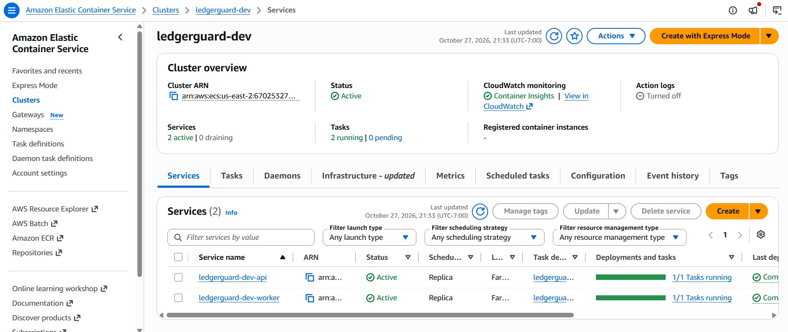
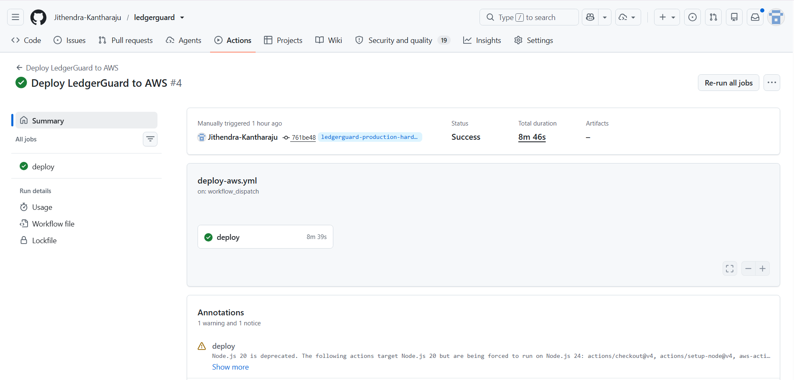
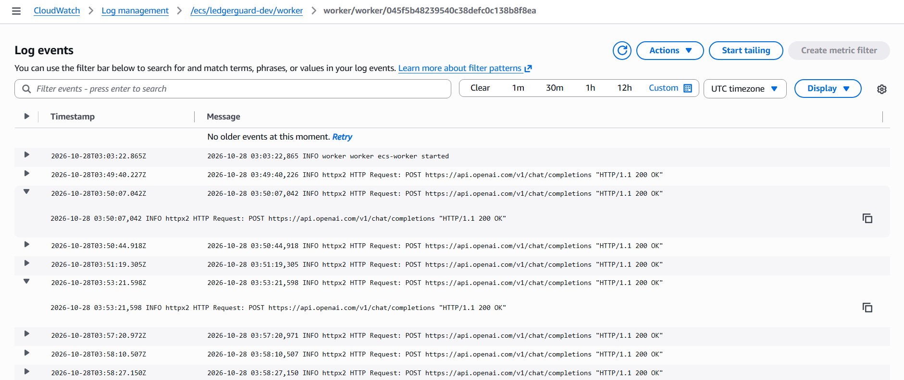

# LedgerGuard — AI-Powered Accounts Payable Automation

**An end-to-end invoice operations system combining document AI, deterministic financial controls, human-in-the-loop approval, and cloud-native delivery.**

`Python` · `FastAPI` · `LangGraph` · `OpenAI` · `PostgreSQL / pgvector` · `React` · `AWS ECS Fargate` · `Terraform` · `GitHub Actions`

> **Deployment status:** LedgerGuard was deployed and demonstrated on AWS using Cognito, ECS Fargate, RDS PostgreSQL, private S3, CloudFront, and GitHub Actions. The AWS demonstration stack was subsequently **decommissioned to avoid ongoing costs**. The public app/API URLs are **not live demos**. The source code, synthetic datasets, screenshots, and deployment evidence remain available here.
>
> **Data and safety:** All showcased invoices and business entities are synthetic. The recorded AWS demo used **shadow mode**: it recorded would-be accounting actions without creating QuickBooks Bills.

**Demo video:** _Add the link to your recorded walkthrough here (YouTube, Loom, or a GitHub Release) before publishing._

## Why LedgerGuard?

Accounts payable teams receive invoices in inconsistent formats, reconcile them against purchase orders and receipts, investigate exceptions, and decide which payments require a human. A language model alone is not a safe decision-maker for financial execution.

LedgerGuard separates **probabilistic document understanding** from **deterministic business authorization**:

1. Ingest a PDF and store it in a private, tenant-scoped document bucket.
2. Parse text or apply OCR for scanned invoices.
3. Extract invoice fields into a structured schema using OpenAI or offline extractors.
4. Validate totals, currency, duplicates, vendor identity, PO status, quantities, and prices.
5. Match invoice lines against authorized purchase orders and goods receipts.
6. Route each document to **reject**, **human review**, or **approval** using customer-specific policies.
7. Allow an authorized reviewer to correct fields or approve, then **revalidate** before any action.
8. Persist jobs, workflow state, and an audit history; use an idempotent outbox for accounting-system integrations.
9. In shadow mode, record the intended execution without posting an external Bill.

## AWS Architecture (deployed demo)



**Cloud delivery:** Terraform provisions networking, security groups, private RDS, S3, ECS services, ECR, Cognito, CloudFront, WAF, certificates, monitoring, and GitHub OIDC permissions. GitHub Actions builds a Docker image, pushes an immutable commit-tagged image to ECR, updates ECS tasks, builds the React app, syncs it to S3, and invalidates CloudFront.



## Product walkthrough

### 1. Human-in-the-loop review

Invoices exceeding the customer's auto-approval limit, scanned documents, or other review-flagged cases are held for a human decision. The approver sees the original PDF next to extracted fields and a reason for review.



### 2. Authorized approval and immutable audit history

The reviewer decision is recorded; the workflow revalidates authorization and invoice evidence. In the AWS demo, the final event was `shadow_would_execute`, **not** a posted accounting Bill.



### 3. Automated path for a valid invoice

A valid invoice passes validation and matching, reaching `shadow_approved` when shadow mode is enabled.



### 4. Deterministic rejection of invalid totals

An invoice whose totals fail financial checks is rejected with an explicit reason rather than being sent for payment.



## Engineering evidence

| Area | Demonstrated implementation |
|---|---|
| **AI engineering** | PDF/OCR preprocessing, schema-constrained extraction, field checks, confidence/risk routing, evaluation harness, adversarial cases |
| **Forward deployed engineering** | Per-customer policy YAML, tenant-scoped access, business-rule customization, review UX, accounting integration boundary, incident troubleshooting |
| **DevOps / platform** | AWS Fargate, RDS, private S3, Cognito, WAF/ALB, CloudFront, Terraform, GitHub Actions OIDC, ECR, CloudWatch |
| **Reliability** | Postgres job queue with `SKIP LOCKED`, leases/retries, durable LangGraph checkpoints, outbox/idempotency and read-back checks in local/mock integration tests |
| **Security** | JWT authentication, role/approval limits, row-level security, least-privilege task roles, shadow execution, audit events, untrusted-document handling |

### AWS services

The demo ran separate **API** and **worker** ECS tasks, both observed running during verification.



### Automated AWS delivery

GitHub Actions deployment **#4** completed successfully, including container deployment and frontend delivery.



### Real OpenAI API traffic

CloudWatch logs captured successful HTTP 200 requests from the deployed worker to the OpenAI API. This confirms API connectivity during the demo; **it is not a measured model-accuracy result**.



## Evaluation and testing

LedgerGuard includes a seeded synthetic-invoice generator and a reproducible offline safety evaluation. These metrics are **rules-based / OCR evaluations**, not the performance of a separately benchmarked live LLM system.

| Metric | Corrected 86-case CI split | Documented 425-case frozen test split |
|---|---:|---:|
| Pipeline processing errors | 0 | 0 |
| Wrong automatic approvals | **0** | **0** |
| Automatic approvals with misread fields | **0** | **0** |
| False rejections | **0** | **0** |
| Seeded bad/problematic cases stopped from auto-approval | **36 / 36** | **225 / 225** |
| Scanned invoices routed to review | **10 / 10** | **50 / 50** |

On the documented frozen split, **72.92% of approvable invoices** were automatically approved using offline extractors; the naive *“PO exists → approve”* baseline produced **256 wrong automatic approvals**. These are synthetic-dataset results, not claims about real customer invoices.

See [`docs/reference-results/test-report.md`](docs/reference-results/test-report.md) for the frozen evaluation report. Local validation also recorded **70 passing Python tests** before subsequent readiness/safety regression additions, with successful React production builds. The full suite should be rerun on any later code changes.

## Key safety and design decisions

- **Rules before LLM confidence:** hard business failures take precedence over model output.
- **Fail closed for scans:** customer policy disables scanned-invoice auto-approval; a human reviews uncertain OCR output.
- **Human approval is not a bypass:** authorization, document version, business checks, and limits are revalidated.
- **Tenant separation:** PostgreSQL row-level security restricts access to tenant records.
- **Durability:** the worker leases jobs from PostgreSQL, retries failures, and checkpoints workflow state.
- **Idempotency:** outbox and read-back logic are exercised against the local/mock accounting adapter; production ERP behavior requires separate verification.
- **No external posting in the cloud demo:** `SHADOW_MODE=true` records `shadow_would_execute` without sending a QuickBooks Bill.

## Technology stack

| Layer | Stack |
|---|---|
| UI | React, TypeScript, Vite |
| Backend | Python, FastAPI, Pydantic |
| Document AI | PyMuPDF, Tesseract OCR, optional Docling, OpenAI structured extraction |
| Orchestration | LangGraph, PostgreSQL worker/job queue |
| Data | PostgreSQL 16, pgvector, private S3 |
| Identity | Amazon Cognito OAuth2/PKCE, JWT, tenant roles |
| Infrastructure | AWS ECS Fargate, RDS, ECR, S3, CloudFront, ALB, WAF, Route 53, ACM |
| Delivery / operations | Terraform, GitHub Actions OIDC, Docker, CloudWatch, OpenTelemetry |
| Test & evaluation | pytest, synthetic invoice generator, frozen split, offline safety gate |

## Run locally

> AWS resources have been decommissioned. **Local Docker development does not require deploying the AWS stack.** Start with the included mock AP provider and shadow mode. Never commit real credentials.

**Prerequisites:** Python (compatible version per `pyproject.toml`), Docker Desktop/Compose, Node.js (version compatible with `ui/package.json`), and Tesseract for scanned-document OCR.

```bash
# Clone the working implementation
 git clone https://github.com/Jithendra-Kantharaju/ledgerguard.git
 cd ledgerguard
 git switch ledgerguard-production-hardening

# Create your private environment file and review its required variables
 cp .env.example .env

# Use safe local settings in .env:
# AUTH_MODE=api_key
# AP_PROVIDER=mock
# SHADOW_MODE=true
# STORAGE_BACKEND=local
# EXTRACTOR=rules
# SECONDARY_EXTRACTOR=rules_alt

# Validate Compose configuration, then start the local services
 docker compose config --quiet
 docker compose up -d --build
 docker compose ps

# Verify local API readiness (after database initialization)
 curl http://localhost:8000/healthz
 curl http://localhost:8000/readyz
```

**Local review UI:** `http://localhost:5173` when the UI service is configured and running. See [`docs/runbook.md`](docs/runbook.md) and `.env.example` for initialization and demo data.

### Reproduce the safety CI evaluation

```bash
python -m pip install -e ".[dev,ocr]"
python -m data.generate --out data/generated --split ci \
  --seed 11 --n-clean 40 --n-scanned 10 --n-per-error 4

# Requires Tesseract installed and on PATH
OCR_BACKEND=tesseract python -m eval.run_eval \
  --split data/generated/ci \
  --baselines --max-wrong-approvals 0
```

Expected dataset size: **86 cases**; the safety gate is designed to exit nonzero if an unsafe automatic approval is detected. OCR-dependent results can vary across environments, so inspect the actual report.

### Repository map

```text
app/api/                FastAPI routes, authentication and tenant checks
app/pipeline/           Parsing, extraction, validation, retrieval, matching, routing
app/worker/             LangGraph workflow, asynchronous worker and queue
app/actions/            Accounting dispatch/outbox logic
app/db/                 PostgreSQL schema, RLS and database access
app/config/             Customer-specific business policies
ui/                     React invoice review dashboard
data/                   Synthetic invoice generator
eval/                   Safety evaluations and reference results
tests/                  Unit and integration coverage
infra/terraform/        Reproducible AWS infrastructure
.github/workflows/      CI and AWS deployment automation
docs/                   Runbooks, evaluation reports and demo screenshots
```

## Deployment status and limitations

- The hosted AWS demonstration environment was **destroyed after recording**; `app.project-jithendra.click` and `api.project-jithendra.click` are not maintained as live endpoints.
- The showcased cloud run used **shadow execution**. QuickBooks sandbox connectivity was tested, but live Bill posting, OAuth refresh under long-running workloads, and accounting reconciliation were **not** established as production-ready.
- The AWS screenshots show real OpenAI API requests, but live model-extraction accuracy, calibrated confidence, and ongoing cost-per-invoice performance have not been fully established in this README.
- Before a real customer deployment: resolve dependency alerts, validate tenant isolation and security controls in the target environment, exercise backup/restore and failure recovery, and benchmark the complete live extraction + ERP workflow.

## Author

Built as a hands-on AI systems and cloud engineering project by [Jithendra Kantharaju](https://github.com/Jithendra-Kantharaju).